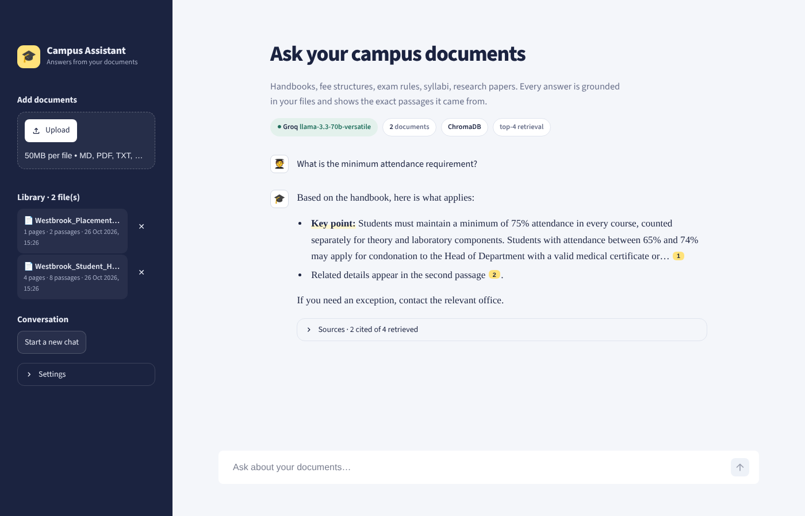

# 🎓 Campus Assistant — RAG chatbot for college documents

Ask plain-language questions about college handbooks, fee structures, exam rules,
syllabi or research papers. Every answer is grounded in your uploaded files and
cites the exact passages it used, so you can verify it in one click.



**Tech stack:** Python · LangChain · ChromaDB / Pinecone · OpenAI, Groq or Ollama (open-source LLMs) · FastEmbed (BGE embeddings) · Streamlit

## Features

- **Upload PDF, DOCX, TXT or Markdown** files from the sidebar; they are cleaned, chunked and indexed in seconds
- **Grounded answers with citations** — numbered chips `[1]` in the answer map to source cards showing the file, page number, match score and the passage itself
- **Conversational memory** — follow-ups like "and what if I have 70%?" are rewritten into standalone search queries before retrieval
- **Suggested questions** generated from your own documents, so new users know what to ask
- **Swap any component** from the Settings panel: LLM provider and model, number of passages, creativity, embeddings, vector database
- **Library management** — duplicate uploads are detected by file hash; remove a file and its vectors are deleted too
- **Runs free** — local embeddings plus Groq's free tier or a fully offline Ollama model
- Sample college handbook and placement FAQ included for instant demos

## Architecture

```
            INDEXING                                       QUESTION ANSWERING
 ┌──────────┐   ┌──────────────┐   ┌───────────┐     ┌──────────┐   ┌───────────────────┐
 │ PDF/DOCX │──►│ Load + clean │──►│ Recursive │     │ Question │──►│ Rewrite follow-up │
 │ TXT/MD   │   │ (page-level) │   │ splitter  │     └──────────┘   │ (uses chat hist.) │
 └──────────┘   └──────────────┘   │ 900 / 150 │                    └─────────┬─────────┘
                                   └─────┬─────┘                              ▼
                                         ▼                          ┌───────────────────┐
                                 ┌───────────────┐   top-k cosine   │  Vector search    │
                                 │  Embeddings   │◄────────────────►│ ChromaDB/Pinecone │
                                 │ BGE-small/OAI │                  └─────────┬─────────┘
                                 └───────────────┘                            ▼
                                                                   ┌───────────────────┐
                                                                   │ Grounded prompt + │
                                                                   │ numbered sources  │──► LLM ──► streamed answer
                                                                   └───────────────────┘          with [n] citations
```

```
campus-rag-assistant/
├── app.py                 # Streamlit UI
├── src/
│   ├── config.py          # settings from .env
│   ├── loaders.py         # file loading, cleaning, chunking
│   ├── vectorstore.py     # embeddings + ChromaDB/Pinecone + file manifest
│   ├── llm.py             # OpenAI / Groq / Ollama factory
│   └── rag.py             # retrieval, prompts, citations, suggestions
├── scripts/ingest.py      # bulk-index a folder from the terminal
├── sample_docs/           # demo handbook (PDF) + placement FAQ (MD)
└── .streamlit/config.toml # theme
```

## How to run it

### 1. Requirements
Python **3.10 – 3.13** and about 1 GB of free disk space.

### 2. Set up the project
```bash
cd campus-rag-assistant
python -m venv .venv

# Windows
.venv\Scripts\activate
# macOS / Linux
source .venv/bin/activate

pip install -r requirements.txt
```

### 3. Choose an LLM (pick one)
Copy the example settings file:
```bash
# Windows
copy .env.example .env
# macOS / Linux
cp .env.example .env
```
Then open `.env` and fill in **one** option:

| Option | Cost | What to do |
|---|---|---|
| **Groq** (recommended for demos) | Free tier | Create a key at console.groq.com/keys and set `GROQ_API_KEY=...` |
| **OpenAI** | Paid, cheap | Set `OPENAI_API_KEY=...` |
| **Ollama** | Free, offline | Install from ollama.com, run `ollama pull llama3.2`, leave keys blank |

Embeddings run locally for free by default. The first run downloads a ~130 MB model once.

### 4. Start the app
```bash
streamlit run app.py
```
It opens at http://localhost:8501. Click **Try it with the sample college handbook**, then pick one of the suggested questions.

### Optional: use Pinecone instead of ChromaDB
Set in `.env`:
```
VECTOR_STORE=Pinecone
PINECONE_API_KEY=...
```
The index (`campus-assistant`) is created automatically with the right dimension. You can also switch the vector database from the Settings panel.

### Optional: index a whole folder from the terminal
```bash
python scripts/ingest.py path/to/your/docs
```

### Troubleshooting
| Problem | Fix |
|---|---|
| "Add GROQ_API_KEY to your .env file" | The key is missing or the app was started before you saved `.env`. Save and restart. |
| "Couldn't reach Ollama" | Run `ollama serve` and `ollama pull llama3.2`. |
| "Model isn't available" | Change the model name in Settings (providers retire models; check their model list). |
| A PDF adds 0 passages | It's a scanned image. Run OCR on it first. |
| Want a clean slate | Stop the app and delete the `data/` folder. |

## Design decisions (good to explain in interviews)

- **Chunking: 900 characters with 150 overlap**, using a recursive splitter that prefers paragraph → line → sentence boundaries. Big enough to hold a full policy rule, small enough to keep retrieval precise. The overlap stops a rule being cut in half at a chunk edge.
- **Cosine similarity, top-4** retrieval. Relevance scores are shown in the UI, which makes retrieval quality visible and debuggable.
- **Query rewriting for follow-ups.** "What about the photocopy fee?" means nothing on its own to a vector search; the LLM first rewrites it using chat history.
- **Hallucination control.** The system prompt forces the model to answer only from the numbered context, cite every factual sentence, and say plainly when the answer isn't in the documents. Low temperature (0.1) by default.
- **Citations are verifiable.** The UI marks which retrieved passages were actually cited and dims the rest.
- **Provider-agnostic.** LangChain interfaces mean the LLM, embeddings and vector database are each one setting. A manifest file keeps library listing and deletion identical across ChromaDB and Pinecone.
- **De-duplication** by SHA-256 hash of the uploaded file.

## Possible extensions

- Hybrid search (BM25 + vectors) and a cross-encoder re-ranker for better precision
- RAGAS evaluation (faithfulness, answer relevance) on a small labelled question set
- OCR for scanned PDFs, table-aware parsing
- User login and per-department document collections
- Deploy on Streamlit Community Cloud or Hugging Face Spaces

## License
MIT. The sample documents describe a fictional institute and are for demo purposes only.
